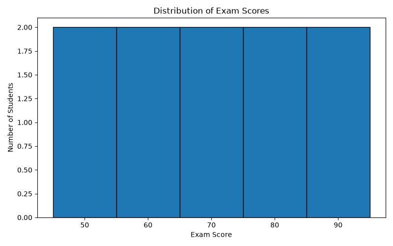
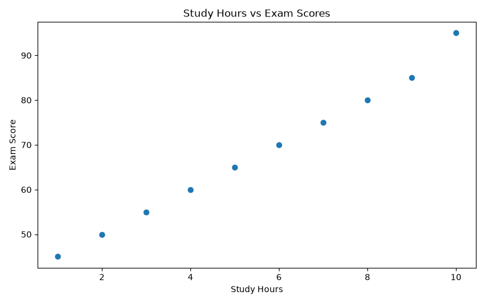
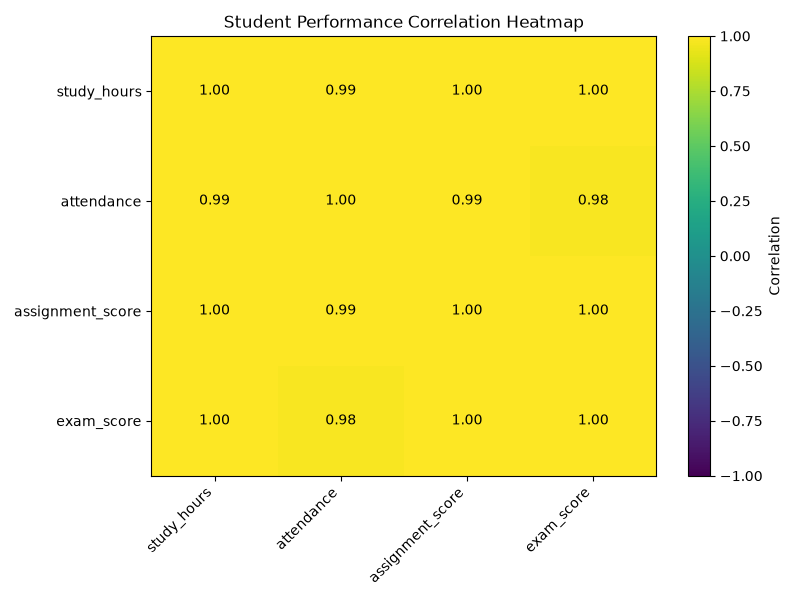

# Student Performance Data Visualization Dashboard

## Project Overview

This project explores student performance data using Python, Pandas, and Matplotlib. It visualizes the relationships between study hours, attendance, assignment scores, and exam scores.

## Objectives

- Analyze the distribution of exam scores.
- Visualize the relationship between study hours and exam scores.
- Explore correlations among student performance indicators.
- Practice data visualization and exploratory data analysis.

## Dataset

The project uses a sample dataset containing 10 students and four variables:

- Study hours
- Attendance
- Assignment scores
- Exam scores

## Visualizations

### 1. Exam Score Distribution

A histogram showing the distribution of student exam scores.

### 2. Study Hours vs. Exam Scores

A scatter plot exploring the relationship between study time and exam performance.

### 3. Correlation Heatmap

A heatmap displaying the correlation coefficients among the four variables.

## Tools and Libraries

- Python
- Pandas
- Matplotlib

## Key Findings

- Exam scores generally increase as study hours increase in this sample.
- Attendance and assignment scores also tend to increase alongside study hours.
- The correlation heatmap helps identify relationships among the variables.

## Limitations

This dataset is simulated and contains only 10 observations. The results are illustrative and cannot be generalized to real student populations. Correlation does not establish causation.

## Future Improvements

- Use a larger real-world dataset.
- Add interactive visualizations.
- Explore statistical relationships using regression analysis.

## Author

Data Analysis Portfolio Project
