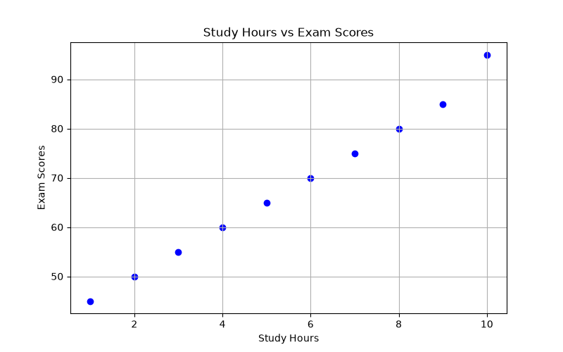
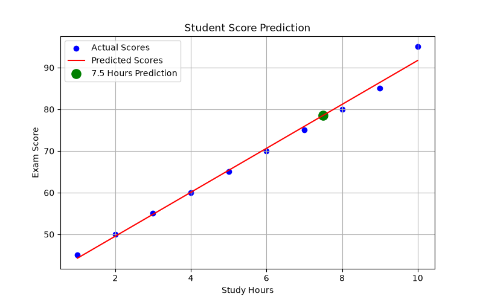
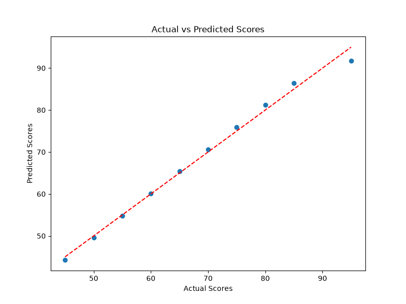

# Student Score Prediction Using Machine Learning

## Project Overview
This project analyzes student performance data and predicts exam scores using linear regression.

## Objectives
- Analyze student performance data
- Explore correlations between study hours and exam scores
- Visualize student performance
- Build a machine learning prediction model
- Evaluate model performance

## Dataset
Synthetic dataset containing 10 students.

Features:
- Study hours
- Attendance rate
- Assignment score
- Exam score

## Technologies
- Python
- pandas
- matplotlib
- scikit-learn

## Machine Learning Model
Algorithm: Linear Regression

Input: Study hours

Target: Exam score

## Results
- Predicted score for 7.5 study hours: 78.90
- Mean Absolute Error (MAE): 1.36
- R-squared (R2): 0.9927

Evaluation was performed on a held-out test set (20% of the data).
Due to the small dataset size, the evaluation metrics may vary significantly.

## Visualizations

### Study Hours vs Exam Scores

### Machine Learning Prediction

### Actual vs Predicted Scores

## Future Improvements
- Use real-world educational datasets
- Split data into training and testing sets
- Explore multiple regression models
- Improve prediction accuracy

